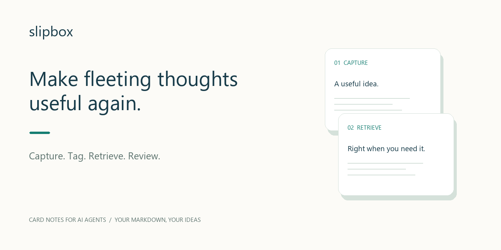
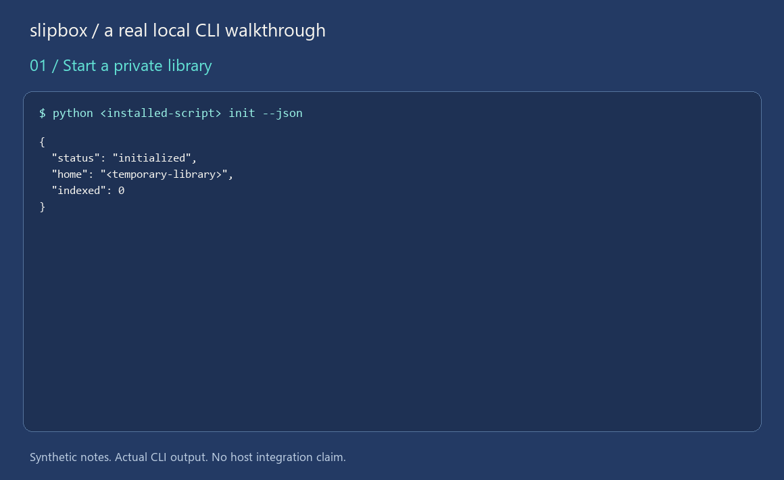

<p align="center"></p>

# slipbox｜跨智能体的 AI 卡片笔记

**用 AI 整理卡片笔记，持续积累，跨智能体复用。**

slipbox 是跨智能体的 AI 卡片笔记工具，让 AI 帮你记录、整理和调用，让同一套卡片在不同平台中持续复用。

[产品首页与交互演示](https://xinyou9999.github.io/slipbox-skill/) · [English](README.md) · [安装](docs/INSTALL.md) · [三分钟体验](docs/QUICKSTART.md) · [复制给 AI 的安装说明](docs/AI_INSTALL.md)

展示页提供中英文、浅深主题与卡片交互演示。演示内容仅保存在当前页面内存中，不连接真实笔记，不调用模型。



*使用合成笔记录制的真实本地 CLI 流程，并非宿主实机演示。* [完整输出](assets/demo-transcript.json) · [静态图](assets/demo-static.png)

## 不只记下来，还能再次用上

读到一个观点、想到一个办法，随手保存，却在需要时想不起放在哪。slipbox 让 Agent 遵循一个简单流程：**记卡片 → 复用标签 → 检索 → 回顾**。

> “记下来：一次好的会议记录，要落到一个明确决定。”
>
> “下次开会前，找出我关于做决定的卡片。”
>
> “回顾这周更新的卡片，展示卡片 ID。”

Agent 理解语义并选择已有标签，脚本负责校验、保存和字面检索。回顾列出近期更新的卡片；总结与解读由宿主模型完成。

## 三个值得安装的理由

- **小卡片，随时拿来用。** 保留原话，通过文字或标签找到具体想法。
- **标签越用越清楚。** 规范名、别名、每卡最多三个标签；新标签明确创建，避免无意中越贴越乱。
- **换个智能体，继续使用同一套卡片。** 多个宿主可访问同一本地库；Python 3.10+、核心无第三方依赖，无内置模型 API 或账号。

在各宿主实际执行环境设置相同的绝对 `SLIPBOX_HOME`；共用资料库要求访问同一个实际本地目录，不包含自动云同步。宿主可能将卡片发送给配置的模型服务，使用前检查其隐私设置。

## 开始使用

1. 从 [v0.1.0 发布页](https://github.com/xinyou9999/slipbox-skill/releases/tag/v0.1.0)获取 ZIP，或从源码构建。
2. 按[安装文档](docs/INSTALL.md)选择宿主。
3. 先做[隔离的三分钟体验](docs/QUICKSTART.md)，再请 Agent 真正记一张卡并找回来。

也可把[安装请求](docs/AI_INSTALL.md)交给 AI：先识别平台和执行环境，再定位脚本、用合成卡片验证；不覆盖已有技能或私人笔记。

| 安装包 | 简体中文 | English |
|---|---|---|
| Codex / Hermes / OpenClaw 通用包 | [下载 ZIP](https://github.com/xinyou9999/slipbox-skill/releases/download/v0.1.0/slipbox-0.1.0-generic-zh.zip) | [Download ZIP](https://github.com/xinyou9999/slipbox-skill/releases/download/v0.1.0/slipbox-0.1.0-generic-en.zip) |
| WorkBuddy 专用包 | [下载 ZIP](https://github.com/xinyou9999/slipbox-skill/releases/download/v0.1.0/slipbox-0.1.0-workbuddy-zh.zip) | [Download ZIP](https://github.com/xinyou9999/slipbox-skill/releases/download/v0.1.0/slipbox-0.1.0-workbuddy-en.zip) |

[SHA-256 校验清单](https://github.com/xinyou9999/slipbox-skill/releases/download/v0.1.0/SHA256SUMS)。当前产品是安装到智能体里的 Skill；本页面提供说明和演示，并非在线笔记编辑器。平台验证状态见下表。

## 宿主状态

**DeepSeek Harness 原生插件已提供下载：**[安装与市场说明](docs/HARNESS_PLUGIN.md) · [下载预构建0.1.1](https://github.com/xinyou9999/slipbox-skill/releases/tag/dsh-v0.1.1)。插件提供真实卡片页面并调用宿主默认模型。**Hermes：**把[安装请求](docs/HERMES_INSTALL_REQUEST.md)整段发给实际运行的智能体即可。

| 宿主 | 安装入口 | 当前证据 |
|---|---|---|
| Codex | 用户/项目 Skill 目录 | 文档核查；未实机验证 |
| Hermes | 当前 profile 的 Skill 目录 | 文档核查；未实机验证 |
| OpenClaw | 共享/工作区 Skill 目录 | 文档核查；未实机验证 |
| WorkBuddy | 上传专用 ZIP | 文档核查；未实机验证 |
| DeepSeek Harness | 原生插件0.1.1；另有通用 Skill | Windows0.2.1-rc.3 原生页面和默认模型流程已在本机验证；其他版本/系统未验证 |

本地包检查不等于平台兼容认证。欢迎提供宿主、版本和实际安装报告，帮助改进这些路径。

## 当前能力与边界

支持记录、列表、搜索、读取、编辑、删除、回顾，以及标签查看/新建/合并和索引重建。当前为字面子串搜索，不是向量或语义搜索；卡片与 `tags.json` 是事实源，SQLite 可重建。

本地写入有互斥保护，但不检测基于旧内容的覆盖编辑，修改前需重读，同一卡片保持一个修改者。DSH 原生插件提供图形卡片编辑页面；通用 Skill 通过宿主智能体操作。暂不包含附件、多用户权限或自动跨设备同步。

## 开发与贡献

```sh
python -m unittest discover -s tests -v
python scripts/verify_release.py
python scripts/package_skill.py --language zh
python scripts/package_skill.py --language en
python scripts/package_skill.py --target workbuddy --language zh
python scripts/package_skill.py --target workbuddy --language en
```

安装包输出到 `dist/`。按环境将 `python` 换为 `python3`。私人笔记与技能安装目录分开保存。

[操作指令](SKILL.md) · [机器可读能力](docs/capabilities.json) · [参与贡献](CONTRIBUTING.md) · [路线图](ROADMAP.md) · [FAQ](docs/FAQ.md) · [安全](SECURITY.md)

如果它对你有帮助，欢迎 Star；一条真实的安装反馈或使用案例，同样能帮助项目进步。

MIT 开源。[许可证](LICENSE) · [版本记录](CHANGELOG.md)
